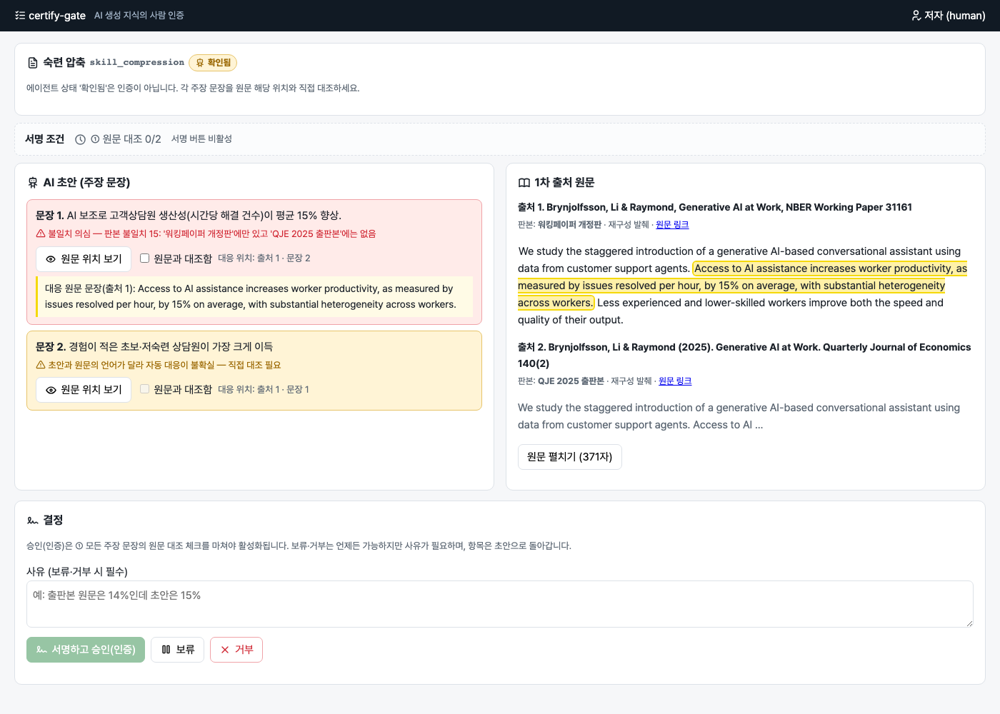

# certify-gate

AI 에이전트가 만든 지식을 사람이 **1차 출처 원문과 대조한 뒤에만** 인증(서명)하게 하는 화면과 상태 모델의 오픈소스 구현입니다.
논문 「암묵지를 끌어내는 인간-AI 인증 루프 설계」(Designing a Human-AI Certification Loop for Eliciting Tacit Knowledge, 홍승우, HCI KOREA 2027 투고 중)의 **그림 4 '인증 화면'**을 구현했습니다.

**이 저장소가 다루는 범위.** 논문이 제안하는 질문-인증 루프 가운데 **인증 화면과 지식 항목의 상태 모델**(초안 → 확인됨 → 인증됨, 서버 측 강제)을 실행 가능한 코드로 공개하고, 논문 4·5장의 **예비 평가 자료**를 함께 둡니다: 인증 화면 벤치마크(스크립트·LLM 인증자), 저자 1인 파일럿 16건([`eval/tacit-pilot/`](eval/tacit-pilot/)), 합성 퍼소나 시뮬레이션([`docs/PERSONA_SIM.md`](docs/PERSONA_SIM.md)), 13문항 제3자 평가([`eval/13q/`](eval/13q/)), 예상 답 생성 프롬프트([`tools/expected-answers/`](tools/expected-answers/)). 루프 전체(라운드 실행, 지식 플랫폼 동기화, 간극 판정)는 포함하지 않습니다.



## 무엇을 하나
- **상태 모델**: `초안(draft) → 확인됨(verified, 에이전트가 출처 일치 확인) → 인증됨(certified, 사람만)`. 보류·거부(사유 필수)는 초안으로 되돌림. 출처가 충돌하는 [쟁점] 항목은 두 해석을 모두 보존. 의사결정용 조회(`/api/decision-kb`)는 인증된 항목만 반환.
- **인증 화면(논문 그림 4)**: 초안 주장 문장과 1차 출처 원문을 나란히 놓고, 숫자·연도·판본 불일치와 인과·단정 표현을 강조. ① 각 주장 문장의 원문 위치를 열어 대조 체크 ② [쟁점] 해석 선택 또는 보류 사유 — 둘을 마치기 전에는 **'서명하고 승인(인증)' 버튼이 비활성**.
- **서버 측 강제**: 게이트 조건·역할을 서버가 검사합니다. 버튼을 클라이언트에서 강제로 활성화하거나 `PATCH`로 상태를 바꿔도 거부되고, 에이전트 역할 토큰은 `certified`로 전이할 수 없습니다.
- **인증 기록**: 누가, 언제, 걸린 시간, 대조한 문장(보기·체크 시각), 결정, 사유, 쟁점 선택을 JSON(`work/certifications.jsonl`, `/api/log`)으로 남깁니다.
- **ontology.json 입출력**: `terms / relations / questions` 형식을 읽고 같은 형식으로 내보냅니다(인증 메타데이터는 추가 필드). 원본 파일은 수정하지 않고 `work/` 복사본으로 작업합니다.

## 실행
```bash
npm install
npm start                        # http://127.0.0.1:5173  (시드: data/seed/ontology.json)
# 다른 ontology.json 가져오기(복사본으로 작업): 목록 화면의 '가져오기' 또는
curl -X POST localhost:5173/api/import -H 'authorization: Bearer human-dev-token' \
     -H 'content-type: application/json' -d '{"path":"/path/to/ontology.json"}'
curl localhost:5173/api/export > ontology.certified.json
```
- 토큰은 `data/users.json`(개발용): `human-dev-token`(사람), `agent-dev-token`(에이전트). 화면은 `?token=`으로 바꿀 수 있습니다.
- 1차 출처 발췌는 `data/seed/sources.json`(출처 키 → 원문 발췌). 시드 발췌 일부는 서지 정보로 **재구성한 것**이라 화면에 '재구성 발췌'로 표시됩니다.
- 시드에는 실제 사례인 **'숙련 압축' 판본 불일치**가 들어 있습니다. Brynjolfsson·Li·Raymond 'Generative AI at Work'의 생산성 향상은 NBER 워킹페이퍼 w31161(2023, 상담원 5,179명)이 **14%**(초보·저숙련 34%, MIT Sloan 기사(2023-06)도 14% 보도), QJE 2025 출판본(140(2), 상담원 5,172명)이 **15%**입니다. 시드 항목은 에이전트가 워킹페이퍼·기사 수치(14%)로 '확인됨'을 붙인 초안이고, 화면은 출판본(15%)과의 판본 불일치를 강조합니다. (2026-11-23 이전 판은 두 판본 수치가 뒤바뀌어 있었습니다. 정정 내용: [docs/BENCHMARK_v2.md](docs/BENCHMARK_v2.md) '정정' 절.)

## 테스트
```bash
npm test                 # 단위·API 테스트 (node:test) — 상태 전이, 서버 강제, 쟁점 보존, 원본 불변
npx playwright install chromium && npm run test:e2e   # E2E, 스크린샷 → docs/screenshots/
```

## 벤치마크 (게이트 있음 vs 없음)
조건 A(게이트 화면) · B(같은 초안+출처, 승인 버튼만) · C(출처 원문 없이 초안만)를 43개 과제(SciFact 27 + ontology.json 실제 항목 16, 오류 19개 심음/자연 오류)로 비교합니다. LLM 에이전트 2개 계열이 Playwright로 화면을 직접 조작하며, '서두르는 인증자' 변형도 돌립니다.
```bash
npm run bench:build                                   # bench/tasks.json, bench/truth.json
node bench/run-bench.mjs --models claude-haiku,codex --variants normal,rushed --tag main
node bench/analyze.mjs main                           # bench/results/summary-main.json, tables-main.md
node bench/pilot.mjs --n 12                           # 사람 파일럿 (docs/PILOT.md)
```
결과·해석·한계: [docs/BENCHMARK.md](docs/BENCHMARK.md) (v1), [docs/BENCHMARK_v2.md](docs/BENCHMARK_v2.md) (v2: 정책 인증자·어려운 세트·주의 제한, 실행 전 커밋한 분석 계획 [docs/PREREG_v2.md](docs/PREREG_v2.md)(커밋 `2307a01`)). **LLM 시뮬레이션은 사람 행동의 대리일 뿐**이며 사람 파일럿 절차를 함께 제공합니다.


## 논문 예비 평가 자료
| 자료 | 위치 | 재현 |
|---|---|---|
| 저자 1인 파일럿 16건(표 3·4) | [`eval/tacit-pilot/`](eval/tacit-pilot/) | `node eval/tacit-pilot/analyze.mjs` |
| 합성 퍼소나 시뮬레이션(표 5) | [`docs/PERSONA_SIM.md`](docs/PERSONA_SIM.md), `bench/persona/` | `node bench/persona/analyze.mjs main2` |
| 인증 화면 벤치마크(5장: 0/336, 84/84, 우회 16종, 59%) | [`docs/BENCHMARK_v2.md`](docs/BENCHMARK_v2.md) | `node bench/v2/policies.mjs --tag v2-exp1` |
| 13문항 제3자 평가(5장, 각주 2) | [`eval/13q/`](eval/13q/) | `python3 eval/13q/analyze.py` |
| 예상 답 생성(3장 ④) | [`tools/expected-answers/`](tools/expected-answers/) | `node tools/expected-answers/generate.mjs tools/expected-answers/example.json` |

## 합성 퍼소나 시뮬레이션
`bench/persona/`: NVIDIA Nemotron-Personas-Korea(**CC BY 4.0**, https://huggingface.co/datasets/nvidia/Nemotron-Personas-Korea) 퍼소나를 LLM이 연기하는 셀프 설문 시뮬레이션. 결과·한계는 [docs/PERSONA_SIM.md](docs/PERSONA_SIM.md)에 있다(**LLM 시뮬레이션, 사람 증거 아님**). 퍼소나 데이터(`bench/persona/data/personas.json`)는 CC BY 4.0을 따르며 MIT 대상이 아니다.

## 구조
```
src/state.js      상태 전이 규칙(순수 함수)      src/server.js   HTTP API + 정적 파일 (의존성 없음)
src/align.js      문장 정렬·불일치 강조          src/store.js    작업 복사본 저장소
src/ontology.js   ontology.json ↔ 항목 변환      public/         인증 화면(A), 기준 화면(B/C), 목록, 파일럿 대기열
bench/            과제 생성·LLM 하네스·분석·파일럿   test/           단위·E2E 테스트
eval/             저자 파일럿·13문항 평가 자료        tools/          예상 답 생성 프롬프트·스크립트
```

## 인용
```
홍승우. 암묵지를 끌어내는 인간-AI 인증 루프 설계. HCI KOREA 2027 (투고 중). 소프트웨어: certify-gate, https://github.com/baryonlabs/certify-gate
```

## 라이선스
코드: MIT (`LICENSE`). 아이콘: Tabler Icons (MIT). `bench/data/scifact_subset.jsonl`: SciFact — claims CC BY 4.0, abstracts ODC-By 1.0 (`bench/data/SCIFACT_LICENSE.md`), MIT 대상 아님.

---

## English summary
**certify-gate** is an MIT-licensed implementation of the human certification screen (Fig. 4) and the knowledge-item state model from the paper *"Designing a Human-AI Certification Loop for Eliciting Tacit Knowledge"* (Sungwoo Hong, submitted to HCI KOREA 2027), together with the paper's preliminary evaluation materials (author pilot, synthetic-persona simulation, certification-screen benchmark, 13-question third-party evaluation, expected-answer prompt).
Knowledge items move `draft → verified (agent may set after matching a primary source) → certified (humans only)`; hold/reject require a reason and send the item back to draft; contested items keep both interpretations; only certified items are exposed for decision-making.
The certify screen puts AI draft sentences next to primary-source text, highlights number/year/edition mismatches and causal overstatement, and keeps the **Sign (certify)** button disabled until every claim sentence has been opened at its source location and checked, and any contested interpretation has been resolved. All rules are enforced server-side (agent tokens cannot certify; client-side bypass is rejected), and each decision is logged as JSON (who, when, duration, sentences checked, decision, reason).
It reads and writes the `ontology.json` format (`terms/relations/questions`) on a working copy. A benchmark compares the gated screen (A) with an approve-only review screen (B) and a draft-only screen (C) on 43 tasks (27 SciFact + 16 real ontology items, 19 seeded/natural errors) using LLM agents from two model families driving the UI via Playwright, including a time-pressured variant, with paired McNemar tests. LLM agents are only proxies for human certifiers; a ready-to-run human pilot procedure is included (`docs/PILOT.md`).
Run: `npm install && npm start`; tests: `npm test && npm run test:e2e`; benchmark: see above and `docs/BENCHMARK.md`.
